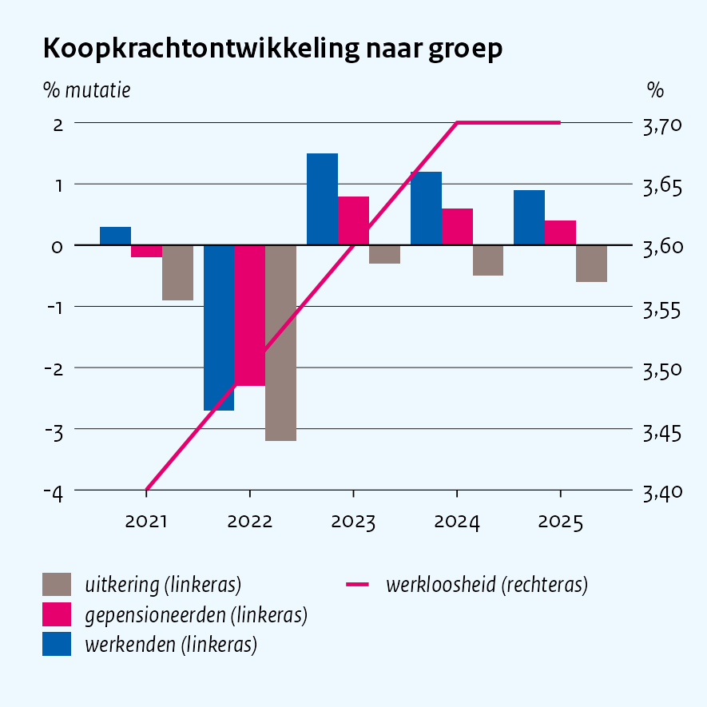
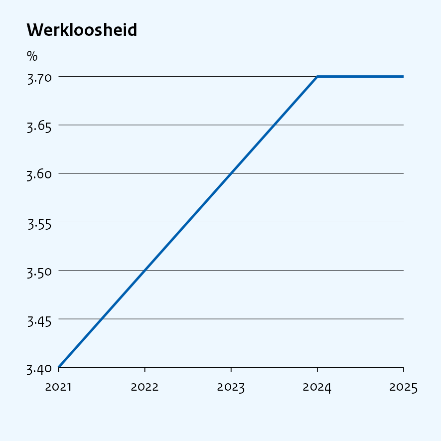

Building figures from CSV files
================

- [Introduction](#introduction)
  - [How to create a figure without opening
    R?](#how-to-create-a-figure-without-opening-r)
- [The dataset](#the-dataset)
- [The parameter file](#the-parameter-file)
  - [Plot types](#plot-types)
  - [Special values](#special-values)
  - [Classes](#classes)
  - [Saving](#saving)
- [Creating the figures using R](#creating-the-figures-using-r)
- [Several datasets](#several-datasets)
  - [A parameter file with one
    figure](#a-parameter-file-with-one-figure)
- [Handling problems](#handling-problems)
- [Appendix A: Parameters](#appendix-a-parameters)

``` r
library(ggcpb)
```

# Introduction

Figures can be created directly with or without using R. This vignette
described the method to create figures **using only Excel**.

To create a figure, you need:

- a `params.csv` file
  - this is the parameter file, which specifies which figures to create
    and how they should be configured
  - one `params.csv` can contain the parameters for several figures
- a `data` folder with the dataset(s)
  - each dataset is a CSV file
- the `run_import.bat` script

*Please note*: The datasets must be saved as CSV, not as spreadsheet
(`xlsx`). In Excel, choose `File` -\> `Save as` -\>
`CSV UTF-8 (comma delimited)`.

## How to create a figure without opening R?

The general workflow to create figures with ggcpb is as follows:

1.  Find the most recent ggcpb version.
2.  Copy it to the place where you want to create figures.
3.  Put your datasets in the folder `data`. Open `params.csv` in Excel
    and add your parameters.
4.  To create a figure, double clik on `run_import.bat`. This reads
    `params.csv`, builds every figure and saves the images in the folder
    `generated`. Each image is named after its dataset. Running the
    script again produces updated figures. Images with the same name are
    replaced. A dataset or figure that fails is skipped and listed at
    the end, and in `params_log.txt`. The other figures are still saved.

R and `ggcpb` must still be installed on the computer running the
script.

# The dataset

Each dataset is a CSV file in the `data` folder. It can have any name.
The first row holds the column names. The package example has two
datasets. One of the example datasets is shown here:

| jaar | groep           | koopkracht | werkloosheid |
|:-----|:----------------|:-----------|:-------------|
| 2021 | werkenden       | 0.3        | 3.4          |
| 2021 | gepensioneerden | -0.2       | 3.4          |
| 2021 | uitkering       | -0.9       | 3.4          |
| 2022 | werkenden       | -2.7       | 3.5          |
| 2022 | gepensioneerden | -2.3       | 3.5          |
| 2022 | uitkering       | -3.2       | 3.5          |
| 2023 | werkenden       | 1.5        | 3.6          |
| 2023 | gepensioneerden | 0.8        | 3.6          |
| 2023 | uitkering       | -0.3       | 3.6          |
| 2024 | werkenden       | 1.2        | 3.7          |
| 2024 | gepensioneerden | 0.6        | 3.7          |
| 2024 | uitkering       | -0.5       | 3.7          |
| 2025 | werkenden       | 0.9        | 3.7          |
| 2025 | gepensioneerden | 0.4        | 3.7          |
| 2025 | uitkering       | -0.6       | 3.7          |

The parameter file refers to variables by their column names.
Categorical columns (e.g. `regio`, `geslacht`) keep the order of the
rows in the created figure. So, the first group in the CSV-file
(e.g. here `werkenden`) is the first on the axis and in the legend.

# The parameter file

The parameter file determines which figures are created. Each figure has
a `plot_type`, together with the settings required for that plot type.
The parameter `data` names the dataset of the figure.

The first column holds the parameter names. Every other column describes
one figure. This is the example parameter file. The first row, with the
plot types, is the header.

<table class="paramtab">

<thead>

<tr>

<th style="text-align:left;">

plot_type
</th>

<th style="text-align:left;">

col
</th>

<th style="text-align:left;">

line
</th>

</tr>

</thead>

<tbody>

<tr>

<td style="text-align:left;">

title
</td>

<td style="text-align:left;">

Koopkrachtontwikkeling naar groep
</td>

<td style="text-align:left;">

Werkloosheid
</td>

</tr>

<tr>

<td style="text-align:left;">

x
</td>

<td style="text-align:left;">

jaar
</td>

<td style="text-align:left;">

jaar
</td>

</tr>

<tr>

<td style="text-align:left;">

y
</td>

<td style="text-align:left;">

koopkracht
</td>

<td style="text-align:left;">

werkloosheid
</td>

</tr>

<tr>

<td style="text-align:left;">

fill
</td>

<td style="text-align:left;">

groep
</td>

<td style="text-align:left;">

</td>

</tr>

<tr>

<td style="text-align:left;">

ylab
</td>

<td style="text-align:left;">

% mutatie
</td>

<td style="text-align:left;">

%
</td>

</tr>

<tr>

<td style="text-align:left;">

position
</td>

<td style="text-align:left;">

dodge
</td>

<td style="text-align:left;">

</td>

</tr>

<tr>

<td style="text-align:left;">

sec_y
</td>

<td style="text-align:left;">

werkloosheid
</td>

<td style="text-align:left;">

</td>

</tr>

<tr>

<td style="text-align:left;">

sec_type
</td>

<td style="text-align:left;">

line
</td>

<td style="text-align:left;">

</td>

</tr>

<tr>

<td style="text-align:left;">

sec_legend_label
</td>

<td style="text-align:left;">

werkloosheid
</td>

<td style="text-align:left;">

</td>

</tr>

<tr>

<td style="text-align:left;">

sec_ylab
</td>

<td style="text-align:left;">

%
</td>

<td style="text-align:left;">

</td>

</tr>

<tr>

<td style="text-align:left;">

create
</td>

<td style="text-align:left;">

y
</td>

<td style="text-align:left;">

y
</td>

</tr>

<tr>

<td style="text-align:left;">

data
</td>

<td style="text-align:left;">

koopkracht
</td>

<td style="text-align:left;">

werkloosheid
</td>

</tr>

<tr>

<td style="text-align:left;">

style
</td>

<td style="text-align:left;">

</td>

<td style="text-align:left;">

english
</td>

</tr>

</tbody>

</table>

This table shows that there are two figures. The first figure (see
[figure 1](#figure-1)) is a column chart (`plot_type` = `col`) that uses
the `koopkracht` dataset (`data`) and that portrays `werkloosheid` on
the second y-axis (`sec_y`). The second figure (see [figure
2](#figure-2)) is a line chart (`plot_type` = `line`) that uses the
`werkloosheid` dataset (`data`) and has no secondary y-axis. A parameter
value can be left blank, such as `sec_y` in the second plot. Only the
second figure sets `style` to `english`, so it gets English labels and
number formats.

The parameter `page` sets the page width a figure is saved at: `half`
(7.5 cm, the default), `full` (15.5 cm) or `small`. If left out, the
default `half` is used.

## Plot types

`plot_type` names the figure type: `line`, `col`, `area`, `box`,
`boxplot_extended`, `dot`, `scatter`, `hist`, `donut` or `map`. Each
type is in R the `cpb_` function of the same name, such as `cpb_line()`.
Every argument of that function can be a parameter. Appendix A lists
them all per plot type.

## Special values

Most values are plain text, a number, `TRUE` or `FALSE`. A few need a
special form:

| Value | Example | What happens |
|----|----|----|
| a list | `0;100` | `;` separates the values. |
| a line break | `First sentence\nsecond sentence` | `\n` starts a new line. |
| no upper limit | `0;20;Inf` | `Inf` and `-Inf` are numbers. |
| a formatter | `euro` | `x_labels` and `sec_axis_labels` take `number` (1.000), `euro` (€1.000) or `pct` (1%). Own labels such as `a;b;c` work too. |
| pairs | `p5:onderste 5%` | `dot_labels` takes name:value pairs. |
| a date | `2024-01-31` | A dataset column of dates gives a date axis. `31-1-2024` works too. |

## Classes

The parameter `cut` puts numbers into classes, such as `0;20;30;40;Inf`.
That gives the classes “lager dan 20”, “20 - 30”, “30 - 40”.

With `style = english` it gives the classes “below 20”, “20 - 30”, “30 -
40” and “40 and above”.

The parameter `cut_labels` says how the class limits are written:

- `number` (default) writes plain numbers, such as “20”.
- `euro` adds a euro sign, such as “€20”.
- `pct` adds a percent sign, such as “20%”.

The classes colour the figure through one column. This is `value` of a
map, `colour` of a line, dot or scatter plot, and `fill` of the other
types. The numbers themselves stay available, for example on the y-axis.

## Saving

Next to `page`, four parameters say how a figure is saved:

| Parameter | Example | What happens |
|----|----|----|
| `height` | `10` | The height in cm. Left out, the page height is used. |
| `preset` | `map` | `map` makes a map as tall as it needs. `presentation` is for slides. |
| `dpi` | `800` | The resolution. The default is 300. |
| `lock` | `FALSE` | A title that is too wide only gives a warning, instead of an error. |

# Creating the figures using R

Pass the parameter file to `cpb_import_csv()`. The datasets are read
from the `data` folder next to it:

``` r
figure_dir <- file.path(tempdir(), "figures")
params_csv <- file.path(figure_dir, "params.csv")
figs <- cpb_import_csv(params_csv)
```

When the parameter file contains multiple figures, `cpb_import_csv()`
returns a named list. The names come from the datasets. Here the two
figures use different datasets, so they are called `koopkracht` and
`werkloosheid`.

`save_cpb()` precisely positions the secondary-axis caption in the
`koopkracht` figure, so the figure is saved using `save_cpb()` rather
than printed directly.

``` r
path <- tempfile(fileext = ".png")
save_cpb(path, figs$koopkracht, page = "half")
```

<a id="figure-1"></a>**Figure 1.** The column chart of the first figure
in `params.csv`.



`werkloosheid` has no second axis, so it can be shown directly:

<a id="figure-2"></a>**Figure 2.** The line chart of the second figure
in `params.csv`.

``` r
figs$werkloosheid
```



# Several datasets

The parameter `data` names the dataset of a figure, relative to the
`data` folder next to `params.csv`. The extension `.csv` is optional, so
`koopkracht` and `koopkracht.csv` are the same dataset.

| Parameter *data* | What happens |
|----|----|
| `koopkracht` | The figure uses `data/koopkracht.csv`. |
| `koopkracht;werkloosheid` | Two figures are made: one from `data/koopkracht.csv` and one from `data/werkloosheid.csv`. |
| blank | The figure uses `data/data.csv`. |
| column absent | The same as blank. |

The figures are named after their dataset. If several figures use the
same dataset, the figure number is added to the name. The first figure
column in `params.csv` is number 1. For example, `koopkracht_1.png` and
`koopkracht_3.png`.

A named dataset that does not exist in the `data` folder is skipped with
a warning. Nothing falls back to another dataset. The other datasets in
the same list and the other rows are still created. With `data` set to
`a;b;c` and no `b.csv`, you get figures for `a` and `c`, and a warning
about `b.csv`.

## A parameter file with one figure

A parameter file can describe a single figure or several figures. When
describing only one figure, it has one column of values next to the
parameter names. For example, the following describes a line chart. It
can be saved in the same folder, so it finds the same `data` folder:

``` r
params_one <- file.path(figure_dir, "params_one.csv")

writeLines(c(
  "plot_type,line",
  "title,Werkloosheid",
  "data,werkloosheid",
  "x,jaar",
  "y,werkloosheid",
  "ylab,%"
), params_one)

cat(readLines(params_one), sep = "\n")
#> plot_type,line
#> title,Werkloosheid
#> data,werkloosheid
#> x,jaar
#> y,werkloosheid
#> ylab,%
```

When the parameter file describes one figure, `cpb_import_csv()` returns
that figure directly rather than a named list. Use `simplify = FALSE` to
always get a named list.

``` r
fig_one <- cpb_import_csv(params_one)
```


# Handling problems

A parameter can be left blank. In that case, the default value is used.

If a parameter is not valid for the selected `plot_type`, it is ignored
and the default is used. This produces a warning.

If a figure cannot be created, for example because a column referenced
by a parameter does not exist in the dataset, that figure is skipped.
Other figures in the same parameter file are still created.

Each call to `cpb_import_csv()` also writes a log file next to the
parameter file. The log records parameter problems and figures that were
created or skipped.

# Appendix A: Parameters

A parameter that refers to a variable (such as `x`, `y` or `fill`) takes
a column name from the dataset. Every other parameter takes a value
directly from the parameter file.

The available parameters depend on the `plot_type`. Table A1 lists every
parameter once, with the plot types it belongs to, its default, an
example and a short description. A default that differs per plot type is
followed by the plot types it holds for.

<span class="table-title">**Table A1. All parameters**</span>

<table class="reftab">

<thead>

<tr>

<th style="text-align:left;">

Parameter
</th>

<th style="text-align:left;">

Plot types
</th>

<th style="text-align:left;">

Default
</th>

<th style="text-align:left;">

Example
</th>

<th style="text-align:left;">

Description
</th>

</tr>

</thead>

<tbody>

<tr>

<td style="text-align:left;">

axis\_<wbr>text\_<wbr>size
</td>

<td style="text-align:left;">

col, line, box, dot, scatter, hist, boxplot_extended
</td>

<td style="text-align:left;">

7
</td>

<td style="text-align:left;">

7
</td>

<td style="text-align:left;">

The size of the axis text, in points.
</td>

</tr>

<tr>

<td style="text-align:left;">

bins
</td>

<td style="text-align:left;">

hist
</td>

<td style="text-align:left;">

none
</td>

<td style="text-align:left;">

30
</td>

<td style="text-align:left;">

The number of bins.
</td>

</tr>

<tr>

<td style="text-align:left;">

binwidth
</td>

<td style="text-align:left;">

hist
</td>

<td style="text-align:left;">

none
</td>

<td style="text-align:left;">

5
</td>

<td style="text-align:left;">

The width of one bin of the histogram.
</td>

</tr>

<tr>

<td style="text-align:left;">

border\_<wbr>colour
</td>

<td style="text-align:left;">

map
</td>

<td style="text-align:left;">

none
</td>

<td style="text-align:left;">

white
</td>

<td style="text-align:left;">

The colour of the region borders.
</td>

</tr>

<tr>

<td style="text-align:left;">

border\_<wbr>linewidth
</td>

<td style="text-align:left;">

map
</td>

<td style="text-align:left;">

0.15
</td>

<td style="text-align:left;">

0.15
</td>

<td style="text-align:left;">

The width of the region borders.
</td>

</tr>

<tr>

<td style="text-align:left;">

box\_<wbr>labels
</td>

<td style="text-align:left;">

box, boxplot_extended
</td>

<td style="text-align:left;">

none
</td>

<td style="text-align:left;">

TRUE
</td>

<td style="text-align:left;">

TRUE prints the values of the box.
</td>

</tr>

<tr>

<td style="text-align:left;">

box\_<wbr>style
</td>

<td style="text-align:left;">

box, boxplot_extended
</td>

<td style="text-align:left;">

<div class="dv">

modern: boxplot\_<wbr>extended

</div>

<div class="dv">

ggcpb: rest

</div>

</td>

<td style="text-align:left;">

<code>ggcpb</code>, <code>james</code>, <code>modern</code> or
<code>dot</code>
</td>

<td style="text-align:left;">

The look of the boxes.
</td>

</tr>

<tr>

<td style="text-align:left;">

cap\_<wbr>width
</td>

<td style="text-align:left;">

dot
</td>

<td style="text-align:left;">

0.25
</td>

<td style="text-align:left;">

0.25
</td>

<td style="text-align:left;">

The width of the end caps of the interval.
</td>

</tr>

<tr>

<td style="text-align:left;">

colour
</td>

<td style="text-align:left;">

line, dot, scatter
</td>

<td style="text-align:left;">

none
</td>

<td style="text-align:left;">

group
</td>

<td style="text-align:left;">

The column that gives lines or points their colour.
</td>

</tr>

<tr>

<td style="text-align:left;">

colour\_<wbr>index
</td>

<td style="text-align:left;">

all
</td>

<td style="text-align:left;">

none
</td>

<td style="text-align:left;">

2;6
</td>

<td style="text-align:left;">

Which house colours to use, by number. The first number is for the first
category.
</td>

</tr>

<tr>

<td style="text-align:left;">

cut
</td>

<td style="text-align:left;">

all
</td>

<td style="text-align:left;">

none
</td>

<td style="text-align:left;">

0;20;40;Inf
</td>

<td style="text-align:left;">

Cuts the numbers of the colour column into classes. The values are the
class limits.
</td>

</tr>

<tr>

<td style="text-align:left;">

cut\_<wbr>labels
</td>

<td style="text-align:left;">

all
</td>

<td style="text-align:left;">

number
</td>

<td style="text-align:left;">

<code>number</code>, <code>euro</code> or <code>pct</code>
</td>

<td style="text-align:left;">

How the class limits are written in the legend.
</td>

</tr>

<tr>

<td style="text-align:left;">

data
</td>

<td style="text-align:left;">

all
</td>

<td style="text-align:left;">

data
</td>

<td style="text-align:left;">

koopkracht
</td>

<td style="text-align:left;">

Excel workflow: CSV file in the data folder. Leave blank for data.csv.
Write a;b for one figure per dataset.
</td>

</tr>

<tr>

<td style="text-align:left;">

dot\_<wbr>labels
</td>

<td style="text-align:left;">

box, boxplot_extended
</td>

<td style="text-align:left;">

none
</td>

<td style="text-align:left;">

p5:bottom 5%;p95:top 5%
</td>

<td style="text-align:left;">

Names for the dots of the dot style, as name:text pairs.
</td>

</tr>

<tr>

<td style="text-align:left;">

dpi
</td>

<td style="text-align:left;">

all
</td>

<td style="text-align:left;">

300
</td>

<td style="text-align:left;">

800
</td>

<td style="text-align:left;">

The sharpness of the saved image, in dots per inch.
</td>

</tr>

<tr>

<td style="text-align:left;">

facet
</td>

<td style="text-align:left;">

col, line, box, dot, scatter, hist, boxplot_extended
</td>

<td style="text-align:left;">

none
</td>

<td style="text-align:left;">

region
</td>

<td style="text-align:left;">

The column that splits the figure into panels. The number of panels
equals the unique values of that column.
</td>

</tr>

<tr>

<td style="text-align:left;">

facet\_<wbr>ncol
</td>

<td style="text-align:left;">

col, line, box, dot, scatter, hist, boxplot_extended
</td>

<td style="text-align:left;">

none
</td>

<td style="text-align:left;">

2
</td>

<td style="text-align:left;">

The maximum number of panels next to each other per row.
</td>

</tr>

<tr>

<td style="text-align:left;">

facet\_<wbr>scales
</td>

<td style="text-align:left;">

col, line, box, dot, scatter, hist, boxplot_extended
</td>

<td style="text-align:left;">

fixed
</td>

<td style="text-align:left;">

<code>fixed</code>, <code>free</code>, <code>free\_<wbr>x</code> or
<code>free\_<wbr>y</code>
</td>

<td style="text-align:left;">

Whether the panels share their axes (fixed) or each have their own
(free).
</td>

</tr>

<tr>

<td style="text-align:left;">

fill
</td>

<td style="text-align:left;">

col, box, hist, donut, boxplot_extended
</td>

<td style="text-align:left;">

required
</td>

<td style="text-align:left;">

group
</td>

<td style="text-align:left;">

The column that splits the bars or areas into colours.
</td>

</tr>

<tr>

<td style="text-align:left;">

fill\_<wbr>colour
</td>

<td style="text-align:left;">

col, box, hist, boxplot_extended
</td>

<td style="text-align:left;">

none
</td>

<td style="text-align:left;">

\#005faf
</td>

<td style="text-align:left;">

One colour for all bars or areas. It is used when <code>fill</code> is
not set.
</td>

</tr>

<tr>

<td style="text-align:left;">

flush\_<wbr>legend
</td>

<td style="text-align:left;">

all
</td>

<td style="text-align:left;">

TRUE
</td>

<td style="text-align:left;">

TRUE
</td>

<td style="text-align:left;">

TRUE places the legend at the left edge of the figure.
</td>

</tr>

<tr>

<td style="text-align:left;">

forecast\_<wbr>label
</td>

<td style="text-align:left;">

col, line, scatter
</td>

<td style="text-align:left;">

raming
</td>

<td style="text-align:left;">

raming
</td>

<td style="text-align:left;">

The word shown in the forecast area.
</td>

</tr>

<tr>

<td style="text-align:left;">

forecast\_<wbr>x
</td>

<td style="text-align:left;">

col, line, scatter
</td>

<td style="text-align:left;">

none
</td>

<td style="text-align:left;">

2025
</td>

<td style="text-align:left;">

The x value where the forecast starts. Everything after it is shaded.
</td>

</tr>

<tr>

<td style="text-align:left;">

grid\_<wbr>colour
</td>

<td style="text-align:left;">

col, line, box, dot, scatter, hist, boxplot_extended
</td>

<td style="text-align:left;">

<div class="dv">

white: boxplot\_<wbr>extended

</div>

<div class="dv">

black: rest

</div>

</td>

<td style="text-align:left;">

black
</td>

<td style="text-align:left;">

The colour of the grid lines.
</td>

</tr>

<tr>

<td style="text-align:left;">

grid\_<wbr>linewidth
</td>

<td style="text-align:left;">

col, line, box, dot, scatter, hist, boxplot_extended
</td>

<td style="text-align:left;">

<div class="dv">

0.8: boxplot\_<wbr>extended

</div>

<div class="dv">

0.1: rest

</div>

</td>

<td style="text-align:left;">

0.1
</td>

<td style="text-align:left;">

The width of the grid lines.
</td>

</tr>

<tr>

<td style="text-align:left;">

group
</td>

<td style="text-align:left;">

col, box, dot, boxplot_extended
</td>

<td style="text-align:left;">

none
</td>

<td style="text-align:left;">

sector
</td>

<td style="text-align:left;">

The column that splits the data into groups.
</td>

</tr>

<tr>

<td style="text-align:left;">

group\_<wbr>gap
</td>

<td style="text-align:left;">

col, box, dot, boxplot_extended
</td>

<td style="text-align:left;">

<div class="dv">

0.8: col

</div>

<div class="dv">

0.7: rest

</div>

</td>

<td style="text-align:left;">

0.8
</td>

<td style="text-align:left;">

The space between the groups, in bar widths.
</td>

</tr>

<tr>

<td style="text-align:left;">

height
</td>

<td style="text-align:left;">

all
</td>

<td style="text-align:left;">

none
</td>

<td style="text-align:left;">

10
</td>

<td style="text-align:left;">

The height of the saved figure in cm. Blank gives the standard height.
</td>

</tr>

<tr>

<td style="text-align:left;">

label
</td>

<td style="text-align:left;">

donut
</td>

<td style="text-align:left;">

none
</td>

<td style="text-align:left;">

name
</td>

<td style="text-align:left;">

The column with the text of each slice.
</td>

</tr>

<tr>

<td style="text-align:left;">

label\_<wbr>accuracy
</td>

<td style="text-align:left;">

box, donut, boxplot_extended
</td>

<td style="text-align:left;">

<div class="dv">

1: donut

</div>

<div class="dv">

0.1: rest

</div>

</td>

<td style="text-align:left;">

0.1
</td>

<td style="text-align:left;">

The rounding of the printed percentages. 0.01 allows for two decimals.
</td>

</tr>

<tr>

<td style="text-align:left;">

label\_<wbr>colour
</td>

<td style="text-align:left;">

donut
</td>

<td style="text-align:left;">

black
</td>

<td style="text-align:left;">

black
</td>

<td style="text-align:left;">

The colour of the labels in the slices.
</td>

</tr>

<tr>

<td style="text-align:left;">

label\_<wbr>style
</td>

<td style="text-align:left;">

donut
</td>

<td style="text-align:left;">

wedge
</td>

<td style="text-align:left;">

<code>wedge</code> or <code>leader</code>
</td>

<td style="text-align:left;">

Prints the label inside the slice (wedge) or outside with a line
(leader).
</td>

</tr>

<tr>

<td style="text-align:left;">

leader\_<wbr>length
</td>

<td style="text-align:left;">

donut
</td>

<td style="text-align:left;">

0.15
</td>

<td style="text-align:left;">

0.15
</td>

<td style="text-align:left;">

The length of the lines to the labels.
</td>

</tr>

<tr>

<td style="text-align:left;">

legend
</td>

<td style="text-align:left;">

all
</td>

<td style="text-align:left;">

<div class="dv">

topleft: map

</div>

<div class="dv">

bottom: rest

</div>

</td>

<td style="text-align:left;">

<code>bottom</code>, <code>right</code>, <code>left</code>,
<code>top</code> or <code>none</code>
</td>

<td style="text-align:left;">

Where the legend is placed. none removes it.
</td>

</tr>

<tr>

<td style="text-align:left;">

legend\_<wbr>ncol
</td>

<td style="text-align:left;">

all
</td>

<td style="text-align:left;">

none
</td>

<td style="text-align:left;">

2
</td>

<td style="text-align:left;">

The number of columns of the legend.
</td>

</tr>

<tr>

<td style="text-align:left;">

legend\_<wbr>nrow
</td>

<td style="text-align:left;">

all
</td>

<td style="text-align:left;">

none
</td>

<td style="text-align:left;">

2
</td>

<td style="text-align:left;">

The number of rows of the legend.
</td>

</tr>

<tr>

<td style="text-align:left;">

legend\_<wbr>pct
</td>

<td style="text-align:left;">

donut
</td>

<td style="text-align:left;">

FALSE
</td>

<td style="text-align:left;">

FALSE
</td>

<td style="text-align:left;">

TRUE adds the percentage to each name in the legend.
</td>

</tr>

<tr>

<td style="text-align:left;">

legend\_<wbr>title
</td>

<td style="text-align:left;">

all
</td>

<td style="text-align:left;">

none
</td>

<td style="text-align:left;">

Legend
</td>

<td style="text-align:left;">

The title of the legend.
</td>

</tr>

<tr>

<td style="text-align:left;">

level
</td>

<td style="text-align:left;">

map
</td>

<td style="text-align:left;">

gemeente
</td>

<td style="text-align:left;">

<code>gemeente</code>, <code>corop</code> or <code>provincie</code>
</td>

<td style="text-align:left;">

The kind of regions on the map.
</td>

</tr>

<tr>

<td style="text-align:left;">

line\_<wbr>colour
</td>

<td style="text-align:left;">

line
</td>

<td style="text-align:left;">

none
</td>

<td style="text-align:left;">

\#005faf
</td>

<td style="text-align:left;">

One colour for the whole line. It is used when <code>colour</code> is
not set.
</td>

</tr>

<tr>

<td style="text-align:left;">

linewidth
</td>

<td style="text-align:left;">

line, box, dot, boxplot_extended
</td>

<td style="text-align:left;">

<div class="dv">

0.55: line

</div>

<div class="dv">

0.4: dot

</div>

<div class="dv">

0.25: rest

</div>

</td>

<td style="text-align:left;">

0.55
</td>

<td style="text-align:left;">

The width of the line.
</td>

</tr>

<tr>

<td style="text-align:left;">

lock
</td>

<td style="text-align:left;">

all
</td>

<td style="text-align:left;">

TRUE
</td>

<td style="text-align:left;">

FALSE
</td>

<td style="text-align:left;">

TRUE stops with a message when the title or legend is wider than the
page. FALSE saves the figure anyway.
</td>

</tr>

<tr>

<td style="text-align:left;">

lower
</td>

<td style="text-align:left;">

dot
</td>

<td style="text-align:left;">

required
</td>

<td style="text-align:left;">

lower\_<wbr>bound
</td>

<td style="text-align:left;">

The column with the lower bound of the interval.
</td>

</tr>

<tr>

<td style="text-align:left;">

mean
</td>

<td style="text-align:left;">

box, boxplot_extended
</td>

<td style="text-align:left;">

none
</td>

<td style="text-align:left;">

mean
</td>

<td style="text-align:left;">

The column with the mean, drawn as a diamond.
</td>

</tr>

<tr>

<td style="text-align:left;">

minor
</td>

<td style="text-align:left;">

col, line, box, dot, scatter, hist, boxplot_extended
</td>

<td style="text-align:left;">

FALSE
</td>

<td style="text-align:left;">

FALSE
</td>

<td style="text-align:left;">

TRUE adds small ticks between the labels.
</td>

</tr>

<tr>

<td style="text-align:left;">

na\_<wbr>fill
</td>

<td style="text-align:left;">

map
</td>

<td style="text-align:left;">

none
</td>

<td style="text-align:left;">

lightgrey
</td>

<td style="text-align:left;">

The colour of regions without a value.
</td>

</tr>

<tr>

<td style="text-align:left;">

orientation
</td>

<td style="text-align:left;">

col, box, dot, boxplot_extended
</td>

<td style="text-align:left;">

<div class="dv">

vertical: col, box

</div>

<div class="dv">

horizontal: rest

</div>

</td>

<td style="text-align:left;">

<code>vertical</code> or <code>horizontal</code>
</td>

<td style="text-align:left;">

Draws the figure upright (vertical) or turned (horizontal).
</td>

</tr>

<tr>

<td style="text-align:left;">

outline
</td>

<td style="text-align:left;">

hist
</td>

<td style="text-align:left;">

white
</td>

<td style="text-align:left;">

white
</td>

<td style="text-align:left;">

The colour of the line around the bars.
</td>

</tr>

<tr>

<td style="text-align:left;">

p25
</td>

<td style="text-align:left;">

box, boxplot_extended
</td>

<td style="text-align:left;">

required
</td>

<td style="text-align:left;">

p25
</td>

<td style="text-align:left;">

The column with the 25th percentile, the bottom of the box.
</td>

</tr>

<tr>

<td style="text-align:left;">

p5
</td>

<td style="text-align:left;">

box, boxplot_extended
</td>

<td style="text-align:left;">

required
</td>

<td style="text-align:left;">

p5
</td>

<td style="text-align:left;">

The column with the 5th percentile, the lower whisker.
</td>

</tr>

<tr>

<td style="text-align:left;">

p50
</td>

<td style="text-align:left;">

box, boxplot_extended
</td>

<td style="text-align:left;">

required
</td>

<td style="text-align:left;">

p50
</td>

<td style="text-align:left;">

The column with the median, the line in the box.
</td>

</tr>

<tr>

<td style="text-align:left;">

p75
</td>

<td style="text-align:left;">

box, boxplot_extended
</td>

<td style="text-align:left;">

required
</td>

<td style="text-align:left;">

p75
</td>

<td style="text-align:left;">

The column with the 75th percentile, the top of the box.
</td>

</tr>

<tr>

<td style="text-align:left;">

p95
</td>

<td style="text-align:left;">

box, boxplot_extended
</td>

<td style="text-align:left;">

required
</td>

<td style="text-align:left;">

p95
</td>

<td style="text-align:left;">

The column with the 95th percentile, the upper whisker.
</td>

</tr>

<tr>

<td style="text-align:left;">

page
</td>

<td style="text-align:left;">

all
</td>

<td style="text-align:left;">

half
</td>

<td style="text-align:left;">

<code>half</code>, <code>full</code> or <code>small</code>
</td>

<td style="text-align:left;">

The width of the saved figure: half is 7.5 cm, full is 15.5 cm and small
is 6.8 cm.
</td>

</tr>

<tr>

<td style="text-align:left;">

palette
</td>

<td style="text-align:left;">

all
</td>

<td style="text-align:left;">

<div class="dv">

sequential: map

</div>

<div class="dv">

qualitative: rest

</div>

</td>

<td style="text-align:left;">

<code>qualitative</code>, <code>discr</code>, <code>sequential</code>,
<code>blues</code> or <code>extended</code>
</td>

<td style="text-align:left;">

The colour set used for the categories.
</td>

</tr>

<tr>

<td style="text-align:left;">

panel\_<wbr>fill
</td>

<td style="text-align:left;">

boxplot_extended
</td>

<td style="text-align:left;">

\#eef8ff
</td>

<td style="text-align:left;">

\#eef8ff
</td>

<td style="text-align:left;">

The colour behind the figure.
</td>

</tr>

<tr>

<td style="text-align:left;">

panel\_<wbr>size
</td>

<td style="text-align:left;">

donut
</td>

<td style="text-align:left;">

none
</td>

<td style="text-align:left;">

1.8
</td>

<td style="text-align:left;">

The size of the figure area in inches. It keeps the ring the same size.
</td>

</tr>

<tr>

<td style="text-align:left;">

pct\_<wbr>axis
</td>

<td style="text-align:left;">

col, line, box, dot, scatter, boxplot_extended
</td>

<td style="text-align:left;">

FALSE
</td>

<td style="text-align:left;">

FALSE
</td>

<td style="text-align:left;">

TRUE writes the values on the axis as percentages.
</td>

</tr>

<tr>

<td style="text-align:left;">

points
</td>

<td style="text-align:left;">

line
</td>

<td style="text-align:left;">

FALSE
</td>

<td style="text-align:left;">

FALSE
</td>

<td style="text-align:left;">

TRUE adds points to the line.
</td>

</tr>

<tr>

<td style="text-align:left;">

position
</td>

<td style="text-align:left;">

col, hist
</td>

<td style="text-align:left;">

stack
</td>

<td style="text-align:left;">

<code>stack</code>, <code>dodge</code> or <code>fill</code>
</td>

<td style="text-align:left;">

How bars of one category are placed: on top of each other
(<code>stack</code>), next to each other (<code>dodge</code>) or as
shares of 100% (<code>fill</code>).
</td>

</tr>

<tr>

<td style="text-align:left;">

preset
</td>

<td style="text-align:left;">

all
</td>

<td style="text-align:left;">

report
</td>

<td style="text-align:left;">

<code>report</code>, <code>presentation</code> or <code>map</code>
</td>

<td style="text-align:left;">

The height of the figure. <code>report</code> is 7.5 cm (6.8 cm for
<code>small</code>), <code>presentation</code> is 6.35 cm and
<code>map</code> is as tall as the map needs.
</td>

</tr>

<tr>

<td style="text-align:left;">

region
</td>

<td style="text-align:left;">

map
</td>

<td style="text-align:left;">

required
</td>

<td style="text-align:left;">

code
</td>

<td style="text-align:left;">

The column with the codes of the municipalities, COROP regions or
provinces.
</td>

</tr>

<tr>

<td style="text-align:left;">

reverse
</td>

<td style="text-align:left;">

map
</td>

<td style="text-align:left;">

FALSE
</td>

<td style="text-align:left;">

FALSE
</td>

<td style="text-align:left;">

TRUE reverses the colours of the gradient of a numeric
<code>value</code> column.
</td>

</tr>

<tr>

<td style="text-align:left;">

reverse\_<wbr>legend
</td>

<td style="text-align:left;">

all
</td>

<td style="text-align:left;">

<div class="dv">

TRUE: col, hist

</div>

<div class="dv">

FALSE: rest

</div>

</td>

<td style="text-align:left;">

TRUE
</td>

<td style="text-align:left;">

TRUE reverses the legend order.
</td>

</tr>

<tr>

<td style="text-align:left;">

ring\_<wbr>width
</td>

<td style="text-align:left;">

donut
</td>

<td style="text-align:left;">

0.6
</td>

<td style="text-align:left;">

0.6
</td>

<td style="text-align:left;">

The thickness of the ring, as a share of the radius.
</td>

</tr>

<tr>

<td style="text-align:left;">

sec\_<wbr>accuracy
</td>

<td style="text-align:left;">

col, line, box, dot, boxplot_extended
</td>

<td style="text-align:left;">

none
</td>

<td style="text-align:left;">

0.1
</td>

<td style="text-align:left;">

The rounding of the numbers on the secondary axis. 0.001 gives three
decimals.
</td>

</tr>

<tr>

<td style="text-align:left;">

sec\_<wbr>at
</td>

<td style="text-align:left;">

col, line, box, dot, boxplot_extended
</td>

<td style="text-align:left;">

none
</td>

<td style="text-align:left;">

0;50;100
</td>

<td style="text-align:left;">

The values at which the secondary axis is labelled.
</td>

</tr>

<tr>

<td style="text-align:left;">

sec\_<wbr>axis\_<wbr>labels
</td>

<td style="text-align:left;">

col, line, box, dot, boxplot_extended
</td>

<td style="text-align:left;">

none
</td>

<td style="text-align:left;">

<code>pct</code>, <code>number</code>, <code>euro</code> or labels such
as <code>a;b;c</code>
</td>

<td style="text-align:left;">

How the numbers on the secondary axis are written, or your own labels.
With a;b;c the ticks get the labels a, b and c, so use as many labels as
ticks (see sec\_<wbr>at).
</td>

</tr>

<tr>

<td style="text-align:left;">

sec\_<wbr>col\_<wbr>width
</td>

<td style="text-align:left;">

col, line, box, dot, boxplot_extended
</td>

<td style="text-align:left;">

0.3
</td>

<td style="text-align:left;">

0.3
</td>

<td style="text-align:left;">

The width of the bars of the second series.
</td>

</tr>

<tr>

<td style="text-align:left;">

sec\_<wbr>colour
</td>

<td style="text-align:left;">

col, line, box, dot, boxplot_extended
</td>

<td style="text-align:left;">

none
</td>

<td style="text-align:left;">

\#e6006e
</td>

<td style="text-align:left;">

The colour of the second series.
</td>

</tr>

<tr>

<td style="text-align:left;">

sec\_<wbr>legend\_<wbr>label
</td>

<td style="text-align:left;">

col, line, box, dot, boxplot_extended
</td>

<td style="text-align:left;">

none
</td>

<td style="text-align:left;">

name of the second series
</td>

<td style="text-align:left;">

The name of the second series in the legend.
</td>

</tr>

<tr>

<td style="text-align:left;">

sec\_<wbr>limits
</td>

<td style="text-align:left;">

col, line, box, dot, boxplot_extended
</td>

<td style="text-align:left;">

none
</td>

<td style="text-align:left;">

0;100
</td>

<td style="text-align:left;">

The lowest and highest value of the secondary axis.
</td>

</tr>

<tr>

<td style="text-align:left;">

sec\_<wbr>linewidth
</td>

<td style="text-align:left;">

col, line, box, dot, boxplot_extended
</td>

<td style="text-align:left;">

<div class="dv">

none: line

</div>

<div class="dv">

0.55: rest

</div>

</td>

<td style="text-align:left;">

0.55
</td>

<td style="text-align:left;">

The line width of the second series.
</td>

</tr>

<tr>

<td style="text-align:left;">

sec\_<wbr>points
</td>

<td style="text-align:left;">

col, line, box, dot, boxplot_extended
</td>

<td style="text-align:left;">

FALSE
</td>

<td style="text-align:left;">

FALSE
</td>

<td style="text-align:left;">

TRUE adds points to the second series when it is a line.
</td>

</tr>

<tr>

<td style="text-align:left;">

sec\_<wbr>scale\_<wbr>auto
</td>

<td style="text-align:left;">

col, line, box, dot, boxplot_extended
</td>

<td style="text-align:left;">

TRUE
</td>

<td style="text-align:left;">

TRUE
</td>

<td style="text-align:left;">

TRUE chooses the secondary axis automatically, so its ticks line up with
the gridlines of the value axis.
</td>

</tr>

<tr>

<td style="text-align:left;">

sec\_<wbr>symbol\_<wbr>size
</td>

<td style="text-align:left;">

col, line, box, dot, boxplot_extended
</td>

<td style="text-align:left;">

<div class="dv">

symbol\_<wbr>size: dot

</div>

<div class="dv">

1.6: rest

</div>

</td>

<td style="text-align:left;">

1.6
</td>

<td style="text-align:left;">

The size of the points of the second series.
</td>

</tr>

<tr>

<td style="text-align:left;">

sec\_<wbr>type
</td>

<td style="text-align:left;">

col, line, box, dot, boxplot_extended
</td>

<td style="text-align:left;">

line
</td>

<td style="text-align:left;">

<code>line</code>, <code>point</code> or <code>col</code>
</td>

<td style="text-align:left;">

How the second series is drawn.
</td>

</tr>

<tr>

<td style="text-align:left;">

sec\_<wbr>y
</td>

<td style="text-align:left;">

col, line, box, dot, boxplot_extended
</td>

<td style="text-align:left;">

none
</td>

<td style="text-align:left;">

unemployment
</td>

<td style="text-align:left;">

The column drawn on a secondary axis.
</td>

</tr>

<tr>

<td style="text-align:left;">

sec\_<wbr>ylab
</td>

<td style="text-align:left;">

col, line, box, dot, boxplot_extended
</td>

<td style="text-align:left;">

none
</td>

<td style="text-align:left;">

unit of the secondary axis
</td>

<td style="text-align:left;">

The unit above the secondary axis.
</td>

</tr>

<tr>

<td style="text-align:left;">

style
</td>

<td style="text-align:left;">

all
</td>

<td style="text-align:left;">

dutch
</td>

<td style="text-align:left;">

<code>dutch</code> or <code>english</code>
</td>

<td style="text-align:left;">

The language of the figure: dutch or english. It sets the number format
(1.000,5 or 1,000.5), the forecast label (raming or forecast), the axis
names in the legend (linkeras and rechteras, or left axis and right
axis) and the class labels of cut.
</td>

</tr>

<tr>

<td style="text-align:left;">

subtitle
</td>

<td style="text-align:left;">

all
</td>

<td style="text-align:left;">

none
</td>

<td style="text-align:left;">

subtitle (replaces the default unit above the figure)
</td>

<td style="text-align:left;">

The text under the title. It replaces the unit.
</td>

</tr>

<tr>

<td style="text-align:left;">

symbol\_<wbr>colour
</td>

<td style="text-align:left;">

dot, scatter
</td>

<td style="text-align:left;">

none
</td>

<td style="text-align:left;">

\#e6006e
</td>

<td style="text-align:left;">

The colour of the dots.
</td>

</tr>

<tr>

<td style="text-align:left;">

symbol\_<wbr>size
</td>

<td style="text-align:left;">

line, dot, scatter
</td>

<td style="text-align:left;">

<div class="dv">

1.1: line

</div>

<div class="dv">

1.4: dot

</div>

<div class="dv">

0.8: rest

</div>

</td>

<td style="text-align:left;">

1.1
</td>

<td style="text-align:left;">

The size of the points.
</td>

</tr>

<tr>

<td style="text-align:left;">

ticks
</td>

<td style="text-align:left;">

col, line, box, dot, scatter, hist, boxplot_extended
</td>

<td style="text-align:left;">

<div class="dv">

FALSE: boxplot\_<wbr>extended

</div>

<div class="dv">

TRUE: rest

</div>

</td>

<td style="text-align:left;">

TRUE
</td>

<td style="text-align:left;">

TRUE draws ticks on the axis.
</td>

</tr>

<tr>

<td style="text-align:left;">

title
</td>

<td style="text-align:left;">

all
</td>

<td style="text-align:left;">

none
</td>

<td style="text-align:left;">

Title of the figure
</td>

<td style="text-align:left;">

The title above the figure.
</td>

</tr>

<tr>

<td style="text-align:left;">

upper
</td>

<td style="text-align:left;">

dot
</td>

<td style="text-align:left;">

required
</td>

<td style="text-align:left;">

upper\_<wbr>bound
</td>

<td style="text-align:left;">

The column with the upper bound of the interval.
</td>

</tr>

<tr>

<td style="text-align:left;">

value
</td>

<td style="text-align:left;">

map
</td>

<td style="text-align:left;">

required
</td>

<td style="text-align:left;">

share
</td>

<td style="text-align:left;">

The column with the values that give the regions their colour.
</td>

</tr>

<tr>

<td style="text-align:left;">

value\_<wbr>accuracy
</td>

<td style="text-align:left;">

col, line, box, dot, scatter, hist, boxplot_extended
</td>

<td style="text-align:left;">

none
</td>

<td style="text-align:left;">

0.1
</td>

<td style="text-align:left;">

The rounding of the numbers on the value axis, such as 0.1.
</td>

</tr>

<tr>

<td style="text-align:left;">

value\_<wbr>axis
</td>

<td style="text-align:left;">

box, boxplot_extended
</td>

<td style="text-align:left;">

<div class="dv">

none: boxplot\_<wbr>extended

</div>

<div class="dv">

bottom: rest

</div>

</td>

<td style="text-align:left;">

<code>bottom</code> or <code>top</code>
</td>

<td style="text-align:left;">

Whether the value axis is at the bottom or at the top.
</td>

</tr>

<tr>

<td style="text-align:left;">

value\_<wbr>axis\_<wbr>linewidth
</td>

<td style="text-align:left;">

boxplot_extended
</td>

<td style="text-align:left;">

0.7
</td>

<td style="text-align:left;">

0.7
</td>

<td style="text-align:left;">

The width of the line of the value axis.
</td>

</tr>

<tr>

<td style="text-align:left;">

value\_<wbr>breaks
</td>

<td style="text-align:left;">

col, line, box, dot, scatter, hist, boxplot_extended
</td>

<td style="text-align:left;">

none
</td>

<td style="text-align:left;">

0;25;50;75;100
</td>

<td style="text-align:left;">

The values at which the value axis is labelled.
</td>

</tr>

<tr>

<td style="text-align:left;">

value\_<wbr>crop
</td>

<td style="text-align:left;">

col, line, box, dot, scatter, hist, boxplot_extended
</td>

<td style="text-align:left;">

FALSE
</td>

<td style="text-align:left;">

FALSE
</td>

<td style="text-align:left;">

TRUE cuts off the data outside the value limits, with a warning.
</td>

</tr>

<tr>

<td style="text-align:left;">

value\_<wbr>labels
</td>

<td style="text-align:left;">

col
</td>

<td style="text-align:left;">

FALSE
</td>

<td style="text-align:left;">

FALSE
</td>

<td style="text-align:left;">

TRUE prints the value on each bar.
</td>

</tr>

<tr>

<td style="text-align:left;">

value\_<wbr>limits
</td>

<td style="text-align:left;">

col, line, box, dot, scatter, hist, boxplot_extended
</td>

<td style="text-align:left;">

none
</td>

<td style="text-align:left;">

0;100
</td>

<td style="text-align:left;">

The lowest and highest value of the value axis. Note: if
value\_<wbr>crop is not TRUE, the axis widens when the data runs past
these limits.
</td>

</tr>

<tr>

<td style="text-align:left;">

wedge\_<wbr>labels
</td>

<td style="text-align:left;">

donut
</td>

<td style="text-align:left;">

TRUE
</td>

<td style="text-align:left;">

TRUE
</td>

<td style="text-align:left;">

TRUE prints the value on each slice.
</td>

</tr>

<tr>

<td style="text-align:left;">

width
</td>

<td style="text-align:left;">

box, boxplot_extended
</td>

<td style="text-align:left;">

<div class="dv">

0.5: box

</div>

<div class="dv">

0.45: rest

</div>

</td>

<td style="text-align:left;">

0.5
</td>

<td style="text-align:left;">

The width of the bars or boxes, as a share of the space.
</td>

</tr>

<tr>

<td style="text-align:left;">

x
</td>

<td style="text-align:left;">

col, line, box, dot, scatter, hist, boxplot_extended
</td>

<td style="text-align:left;">

required
</td>

<td style="text-align:left;">

year
</td>

<td style="text-align:left;">

The column with the categories or numbers on the x-axis.
</td>

</tr>

<tr>

<td style="text-align:left;">

x\_<wbr>labels
</td>

<td style="text-align:left;">

scatter
</td>

<td style="text-align:left;">

none
</td>

<td style="text-align:left;">

<code>euro</code>, <code>number</code>, <code>pct</code> or labels such
as <code>a;b;c</code>
</td>

<td style="text-align:left;">

How the numbers on the x-axis are written, or your own labels. With
a;b;c the ticks get the labels a, b and c, so use as many labels as
ticks.
</td>

</tr>

<tr>

<td style="text-align:left;">

x\_<wbr>lim
</td>

<td style="text-align:left;">

col, line, box, dot, scatter, hist, boxplot_extended
</td>

<td style="text-align:left;">

none
</td>

<td style="text-align:left;">

2015;2025
</td>

<td style="text-align:left;">

The first and last value shown on the x-axis.
</td>

</tr>

<tr>

<td style="text-align:left;">

x\_<wbr>lim\_<wbr>follow\_<wbr>data
</td>

<td style="text-align:left;">

col, line, box, dot, scatter, hist, boxplot_extended
</td>

<td style="text-align:left;">

<div class="dv">

FALSE: col, scatter, hist

</div>

<div class="dv">

TRUE: rest

</div>

</td>

<td style="text-align:left;">

FALSE
</td>

<td style="text-align:left;">

TRUE lets the x-axis follow the data when it runs past x\_<wbr>lim.
</td>

</tr>

<tr>

<td style="text-align:left;">

x\_<wbr>ticks\_<wbr>ends
</td>

<td style="text-align:left;">

col, line
</td>

<td style="text-align:left;">

FALSE
</td>

<td style="text-align:left;">

FALSE
</td>

<td style="text-align:left;">

TRUE also labels the first and last month of a monthly axis.
</td>

</tr>

<tr>

<td style="text-align:left;">

xlab
</td>

<td style="text-align:left;">

col, line, box, dot, scatter, hist, boxplot_extended
</td>

<td style="text-align:left;">

none
</td>

<td style="text-align:left;">

unit below the x-axis
</td>

<td style="text-align:left;">

The text next to the x-axis.
</td>

</tr>

<tr>

<td style="text-align:left;">

y
</td>

<td style="text-align:left;">

col, line, dot, scatter, donut
</td>

<td style="text-align:left;">

required
</td>

<td style="text-align:left;">

purchasing\_<wbr>power
</td>

<td style="text-align:left;">

The column with the values.
</td>

</tr>

<tr>

<td style="text-align:left;">

ylab
</td>

<td style="text-align:left;">

col, line, box, dot, scatter, hist, boxplot_extended
</td>

<td style="text-align:left;">

none
</td>

<td style="text-align:left;">

% change
</td>

<td style="text-align:left;">

The unit above the value axis.
</td>

</tr>

<tr>

<td style="text-align:left;">

ylab\_<wbr>position
</td>

<td style="text-align:left;">

boxplot_extended
</td>

<td style="text-align:left;">

none
</td>

<td style="text-align:left;">

<code>left</code>, <code>middle</code> or <code>right</code>
</td>

<td style="text-align:left;">

Where the unit is placed: left, middle or right.
</td>

</tr>

<tr>

<td style="text-align:left;">

ymax
</td>

<td style="text-align:left;">

line
</td>

<td style="text-align:left;">

none
</td>

<td style="text-align:left;">

upper\_<wbr>bound
</td>

<td style="text-align:left;">

The column with the upper end of an uncertainty band.
</td>

</tr>

<tr>

<td style="text-align:left;">

ymin
</td>

<td style="text-align:left;">

line
</td>

<td style="text-align:left;">

none
</td>

<td style="text-align:left;">

lower\_<wbr>bound
</td>

<td style="text-align:left;">

The column with the lower end of an uncertainty band.
</td>

</tr>

<tr>

<td style="text-align:left;">

zero\_<wbr>indicator
</td>

<td style="text-align:left;">

boxplot_extended
</td>

<td style="text-align:left;">

none
</td>

<td style="text-align:left;">

TRUE
</td>

<td style="text-align:left;">

TRUE draws a thick white line at zero behind the data.
</td>

</tr>

<tr>

<td style="text-align:left;">

zero\_<wbr>indicator\_<wbr>linewidth
</td>

<td style="text-align:left;">

boxplot_extended
</td>

<td style="text-align:left;">

2
</td>

<td style="text-align:left;">

2
</td>

<td style="text-align:left;">

The width of the white zero line.
</td>

</tr>

<tr>

<td style="text-align:left;">

zeroline
</td>

<td style="text-align:left;">

col, line, box, dot, scatter, hist
</td>

<td style="text-align:left;">

<div class="dv">

TRUE: col, hist

</div>

<div class="dv">

none: rest

</div>

</td>

<td style="text-align:left;">

TRUE
</td>

<td style="text-align:left;">

TRUE draws a line at zero. Blank draws it only when zero is on the axis.
</td>

</tr>

</tbody>

</table>
