Introduction to ggcpb
================

<style>
.figrow { display: flex; gap: 24px; align-items: flex-start; margin: 1em 0; }
.figrow > * { flex: 1 1 0; min-width: 0; }
.figrow table { font-size: 0.85em; }
table.ptab { background: none; border-collapse: collapse; width: 100%; }
table.ptab tr, table.ptab tr:nth-child(odd), table.ptab tr:nth-child(even),
table.ptab th, table.ptab td { background: none; border: none; }
table.ptab th, table.ptab td { border-bottom: 1px solid #bbb; padding: 4px 6px; }
table.ptab th { border-top: 2px solid #bbb; }
.figrow h4 { margin-top: 0; color: #c02a6a; }
@media (max-width: 600px) { .figrow { display: block; } }
</style>

This vignette gives a short introduction to creating customizable CPB
style figures with ggcpb.

# What is ggcpb?

ggcpb is the new version of James. It draws figures in the CPB house
style from Excel or from R.

## Why ggcpb instead of James?

ggcpb is more future proof. It is built on ggplot2, the most widely used
plotting package in R. This brings the following benefits:

- **More possibilities.** Anything ggplot2 can do, ggcpb can do. If you
  need an extra layer or a special annotation, you can add it. It allows
  for new figure types that were not possible with James, such as a
  donut chart.
- **Easier to maintain.** ggcpb adds a thin layer to a well tested
  package.

## What you need to know

This is the general workflow to create figures with ggcpb.

1.  Find the most recent ggcpb folder in `[path]`.
2.  Copy it to the place where you want to create figures.
3.  Put your datasets in the folder `data`. Open `params.csv` in Excel
    and describe your figures.
4.  Start `run_import.bat` (Windows) by double clicking it. Your figures
    appear in the folder `generated`.

You do not need to know R to follow this workflow.

## Use ggcpb in Excel

One parameter file and one or more datasets drive everything.

- `params.csv` describes your figures. Each row forms one figure. Each
  column holds the parameter settings for a specific figure. The column
  `data` names the dataset of the figure.
- The folder `data` holds your datasets. Each dataset is its own CSV
  file with any name, such as `koopkracht.csv`. The first row holds the
  column names. The following rows are the observations per column.

Leave `data` blank to use `data/data.csv`. Write `a.csv;b.csv` to draw
the same figure for both datasets. A figure is saved under the name of
its dataset, so `koopkracht.csv` gives `koopkracht.png`. If two figures
use the same dataset, the row number is added, such as
`koopkracht_1.png`.

*Please note*: The files must be saved as CSV, not as spreadsheet
(`xlsx`). In Excel, choose `File` -\> `Save as` -\>
`CSV UTF-8 (comma delimited)`.

Run the script again after every change. This will update the figures.
The import vignette gives a more detailed explanation and lists all
settings per figure type. See [`vignette("import")`](import.md).

## Use ggcpb in R

Next to plotting Excel data with ggcpb, you can also plot data that you
already have in R. The caption below each figure in this introduction
shows the function to use. Load the package first.

``` r
library(ggcpb)
```

Each figure type has its own function.

``` r
# Line chart
cpb_line(data = df, x = year, y = value)
# Bar chart
cpb_col(data = df, x = year, y = value, fill = group)
# Area chart
cpb_area(data = df, x = year, y = value, fill = group)
# Box plot
cpb_box(data = df, x = group, p5 = p5, p25 = p25, p50 = p50, p75 = p75, p95 = p95)
# Dot plot
cpb_dot(data = df, x = term, y = estimate, lower = lower, upper = upper)
# Donut chart
cpb_donut(data = df, fill = group, y = share)
# Scatter plot
cpb_scatter(data = df, x = income, y = spending)
# Histogram
cpb_hist(data = df, x = duration)
# Map
cpb_map(data = df, region = code, value = share)
```

To export a figure, use `save_cpb()`. It writes the figure at the CPB
page widths. Use `page = "half"` for 7.5 cm and `page = "full"` for 15.5
cm.

``` r
save_cpb("zonnepanelen.png", p, page = "half")
```

The rest of this introduction assumes that you work in Excel.

# Figure types

Each figure below is combined with a feature that you can also use with
several other plot types, if not all. The parameters and their
corresponding values are portrayed next to the figure. Other settings
keep their default.

It is possible to set the style for a whole publication. Dutch is the
default. An English report can use `style = english` in `params.csv`, or
`options(ggcpb.style = "english")` in R.

## Line with forecast

A line chart with a forecast window and an uncertainty band.

<div class="figrow">

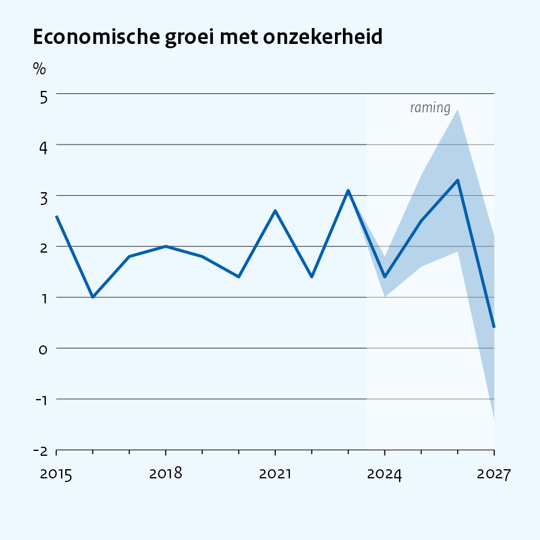

<div>

#### Relevant parameters

<table class="ptab">

<thead>

<tr>

<th style="text-align:left;">

parameter
</th>

<th style="text-align:right;">

value
</th>

</tr>

</thead>

<tbody>

<tr>

<td style="text-align:left;">

plot_type
</td>

<td style="text-align:right;">

line
</td>

</tr>

<tr>

<td style="text-align:left;">

title
</td>

<td style="text-align:right;">

Economische groei met onzekerheid
</td>

</tr>

<tr>

<td style="text-align:left;">

x
</td>

<td style="text-align:right;">

jaar
</td>

</tr>

<tr>

<td style="text-align:left;">

y
</td>

<td style="text-align:right;">

groei
</td>

</tr>

<tr>

<td style="text-align:left;">

ymin
</td>

<td style="text-align:right;">

lo
</td>

</tr>

<tr>

<td style="text-align:left;">

ymax
</td>

<td style="text-align:right;">

hi
</td>

</tr>

<tr>

<td style="text-align:left;">

forecast_x
</td>

<td style="text-align:right;">

2023.5
</td>

</tr>

<tr>

<td style="text-align:left;">

ylab
</td>

<td style="text-align:right;">

%
</td>

</tr>

</tbody>

</table>

</div>

</div>

**How to reproduce this figure:** copy `params.csv`, the folder `data`
and `run_import.bat` (Windows) or `run_import.command` (Mac) to a
personal folder. Fill in the parameters above in `params.csv` and start
the script. In R you can call `cpb_line()` instead. See section 1.4.

## Columns with two axes

Two series on one figure, with the second series on the right axis. The
legend tells you which axis belongs to which series.

<div class="figrow">

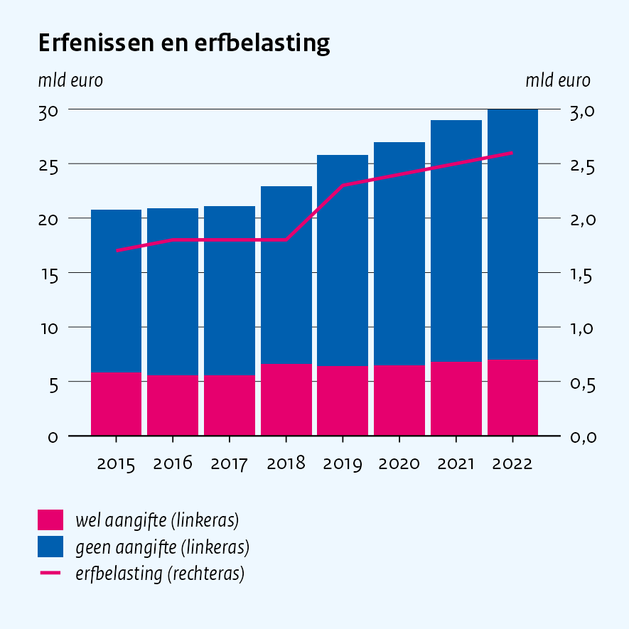

<div>

#### Relevant parameters

<table class="ptab">

<thead>

<tr>

<th style="text-align:left;">

parameter
</th>

<th style="text-align:right;">

value
</th>

</tr>

</thead>

<tbody>

<tr>

<td style="text-align:left;">

plot_type
</td>

<td style="text-align:right;">

col
</td>

</tr>

<tr>

<td style="text-align:left;">

title
</td>

<td style="text-align:right;">

Erfenissen en erfbelasting
</td>

</tr>

<tr>

<td style="text-align:left;">

x
</td>

<td style="text-align:right;">

jaar
</td>

</tr>

<tr>

<td style="text-align:left;">

y
</td>

<td style="text-align:right;">

mld
</td>

</tr>

<tr>

<td style="text-align:left;">

fill
</td>

<td style="text-align:right;">

soort
</td>

</tr>

<tr>

<td style="text-align:left;">

sec_y
</td>

<td style="text-align:right;">

heffing
</td>

</tr>

<tr>

<td style="text-align:left;">

sec_limits
</td>

<td style="text-align:right;">

0;3
</td>

</tr>

<tr>

<td style="text-align:left;">

sec_legend_label
</td>

<td style="text-align:right;">

erfbelasting
</td>

</tr>

<tr>

<td style="text-align:left;">

sec_ylab
</td>

<td style="text-align:right;">

mld euro
</td>

</tr>

<tr>

<td style="text-align:left;">

ylab
</td>

<td style="text-align:right;">

mld euro
</td>

</tr>

</tbody>

</table>

</div>

</div>

**How to reproduce this figure:** copy `params.csv`, the folder `data`
and `run_import.bat` (Windows) or `run_import.command` (Mac) to a
personal folder. Fill in the parameters above in `params.csv` and start
the script. In R you can call `cpb_col()` instead. See section 1.4.

## Horizontal bars with chosen colours

The colours decide the legend. Pick them with `colour_index`.

<div class="figrow">

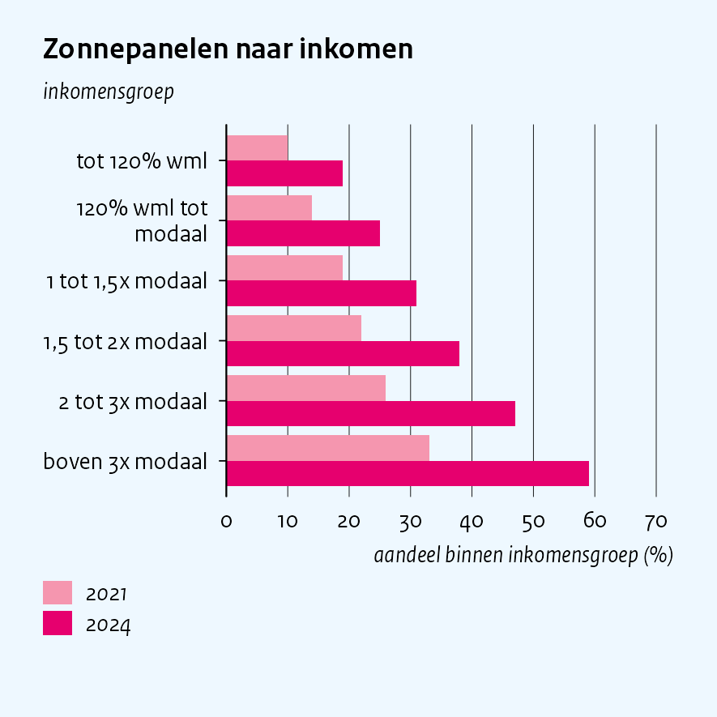

<div>

#### Relevant parameters

<table class="ptab">

<thead>

<tr>

<th style="text-align:left;">

parameter
</th>

<th style="text-align:right;">

value
</th>

</tr>

</thead>

<tbody>

<tr>

<td style="text-align:left;">

plot_type
</td>

<td style="text-align:right;">

col
</td>

</tr>

<tr>

<td style="text-align:left;">

title
</td>

<td style="text-align:right;">

Zonnepanelen naar inkomen
</td>

</tr>

<tr>

<td style="text-align:left;">

x
</td>

<td style="text-align:right;">

groep
</td>

</tr>

<tr>

<td style="text-align:left;">

y
</td>

<td style="text-align:right;">

aandeel
</td>

</tr>

<tr>

<td style="text-align:left;">

fill
</td>

<td style="text-align:right;">

jaar
</td>

</tr>

<tr>

<td style="text-align:left;">

position
</td>

<td style="text-align:right;">

dodge
</td>

</tr>

<tr>

<td style="text-align:left;">

orientation
</td>

<td style="text-align:right;">

horizontal
</td>

</tr>

<tr>

<td style="text-align:left;">

colour_index
</td>

<td style="text-align:right;">

2;1
</td>

</tr>

<tr>

<td style="text-align:left;">

value_limits
</td>

<td style="text-align:right;">

0;70
</td>

</tr>

<tr>

<td style="text-align:left;">

ylab
</td>

<td style="text-align:right;">

inkomensgroep
</td>

</tr>

<tr>

<td style="text-align:left;">

xlab
</td>

<td style="text-align:right;">

aandeel binnen inkomensgroep (%)
</td>

</tr>

</tbody>

</table>

</div>

</div>

**How to reproduce this figure:** copy `params.csv`, the folder `data`
and `run_import.bat` (Windows) or `run_import.command` (Mac) to a
personal folder. Fill in the parameters above in `params.csv` and start
the script. In R you can call `cpb_col()` instead. See section 1.4.

## Line with markers in English

A line with markers suits a few ordered categories. This figure uses the
English style.

<div class="figrow">

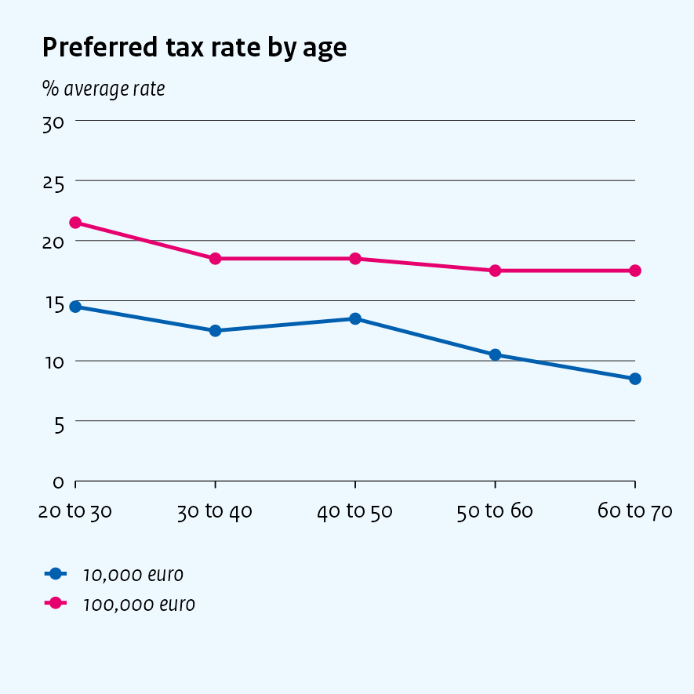

<div>

#### Relevant parameters

<table class="ptab">

<thead>

<tr>

<th style="text-align:left;">

parameter
</th>

<th style="text-align:right;">

value
</th>

</tr>

</thead>

<tbody>

<tr>

<td style="text-align:left;">

plot_type
</td>

<td style="text-align:right;">

line
</td>

</tr>

<tr>

<td style="text-align:left;">

title
</td>

<td style="text-align:right;">

Preferred tax rate by age
</td>

</tr>

<tr>

<td style="text-align:left;">

x
</td>

<td style="text-align:right;">

leeftijd
</td>

</tr>

<tr>

<td style="text-align:left;">

y
</td>

<td style="text-align:right;">

tarief
</td>

</tr>

<tr>

<td style="text-align:left;">

colour
</td>

<td style="text-align:right;">

erfenis
</td>

</tr>

<tr>

<td style="text-align:left;">

points
</td>

<td style="text-align:right;">

TRUE
</td>

</tr>

<tr>

<td style="text-align:left;">

value_limits
</td>

<td style="text-align:right;">

0;30
</td>

</tr>

<tr>

<td style="text-align:left;">

style
</td>

<td style="text-align:right;">

english
</td>

</tr>

<tr>

<td style="text-align:left;">

ylab
</td>

<td style="text-align:right;">

% average rate
</td>

</tr>

</tbody>

</table>

</div>

</div>

**How to reproduce this figure:** copy `params.csv`, the folder `data`
and `run_import.bat` (Windows) or `run_import.command` (Mac) to a
personal folder. Fill in the parameters above in `params.csv` and start
the script. In R you can call `cpb_line()` instead. See section 1.4.

## Boxplot

A box shows the 25th to 75th percentile. The line in the box is the
median. The whiskers run from the 5th to the 95th percentile.

<div class="figrow">

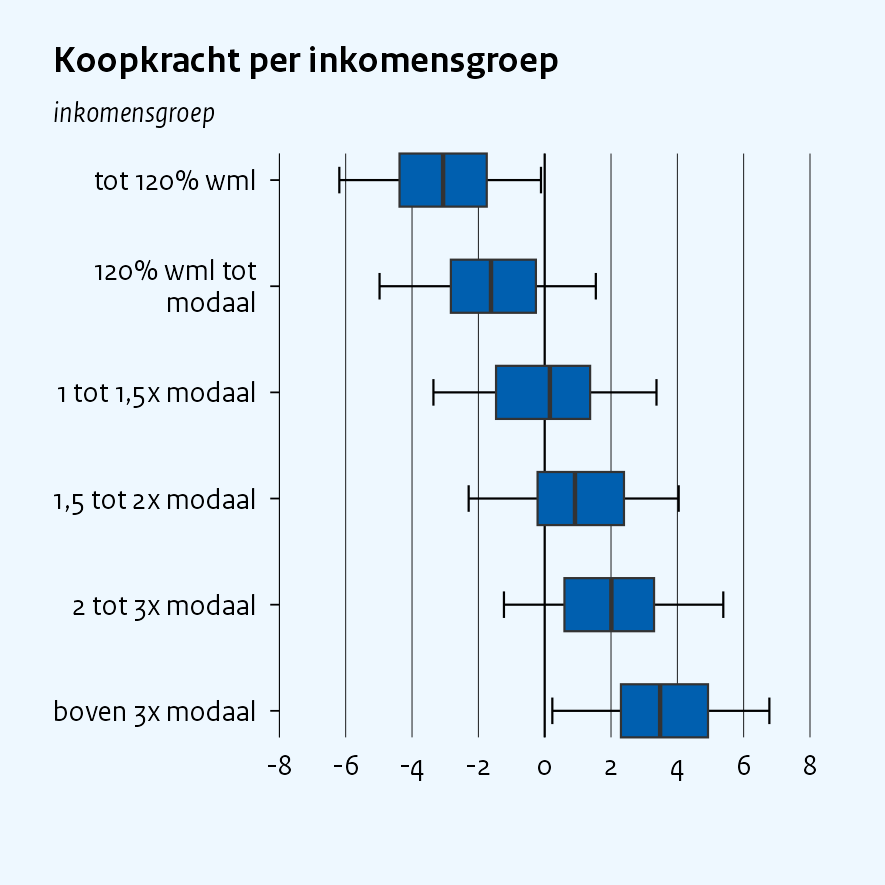

<div>

#### Relevant parameters

<table class="ptab">

<thead>

<tr>

<th style="text-align:left;">

parameter
</th>

<th style="text-align:right;">

value
</th>

</tr>

</thead>

<tbody>

<tr>

<td style="text-align:left;">

plot_type
</td>

<td style="text-align:right;">

box
</td>

</tr>

<tr>

<td style="text-align:left;">

title
</td>

<td style="text-align:right;">

Koopkracht per inkomensgroep
</td>

</tr>

<tr>

<td style="text-align:left;">

x
</td>

<td style="text-align:right;">

groep
</td>

</tr>

<tr>

<td style="text-align:left;">

p5
</td>

<td style="text-align:right;">

p5
</td>

</tr>

<tr>

<td style="text-align:left;">

p25
</td>

<td style="text-align:right;">

p25
</td>

</tr>

<tr>

<td style="text-align:left;">

p50
</td>

<td style="text-align:right;">

p50
</td>

</tr>

<tr>

<td style="text-align:left;">

p75
</td>

<td style="text-align:right;">

p75
</td>

</tr>

<tr>

<td style="text-align:left;">

p95
</td>

<td style="text-align:right;">

p95
</td>

</tr>

<tr>

<td style="text-align:left;">

orientation
</td>

<td style="text-align:right;">

horizontal
</td>

</tr>

<tr>

<td style="text-align:left;">

subtitle
</td>

<td style="text-align:right;">

inkomensgroep
</td>

</tr>

<tr>

<td style="text-align:left;">

ylab
</td>

<td style="text-align:right;">

% koopkrachtmutatie
</td>

</tr>

</tbody>

</table>

</div>

</div>

**How to reproduce this figure:** copy `params.csv`, the folder `data`
and `run_import.bat` (Windows) or `run_import.command` (Mac) to a
personal folder. Fill in the parameters above in `params.csv` and start
the script. In R you can call `cpb_box()` instead. See section 1.4.

More box plot styles are in [`vignette("boxplots")`](boxplots.md).

## Donut chart

Individual categories add up to 100% in the donut chart. Categories
don’t need to be expressed as percentages. Any numerical values will
work, as the donut chart automatically calculates the proportions.

<div class="figrow">

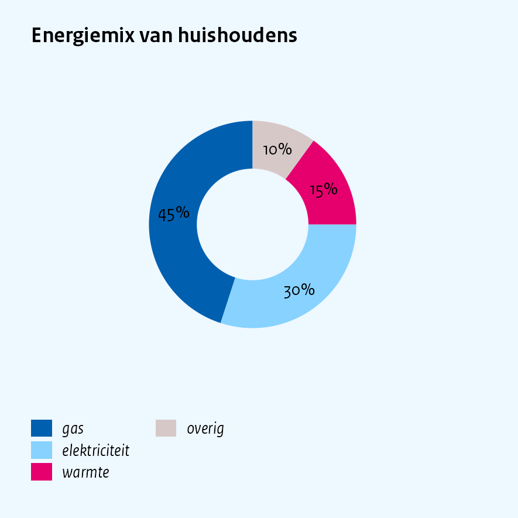

<div>

#### Relevant parameters

<table class="ptab">

<thead>

<tr>

<th style="text-align:left;">

parameter
</th>

<th style="text-align:right;">

value
</th>

</tr>

</thead>

<tbody>

<tr>

<td style="text-align:left;">

plot_type
</td>

<td style="text-align:right;">

donut
</td>

</tr>

<tr>

<td style="text-align:left;">

title
</td>

<td style="text-align:right;">

Energiemix van huishoudens
</td>

</tr>

<tr>

<td style="text-align:left;">

fill
</td>

<td style="text-align:right;">

bron
</td>

</tr>

<tr>

<td style="text-align:left;">

y
</td>

<td style="text-align:right;">

aandeel
</td>

</tr>

<tr>

<td style="text-align:left;">

colour_index
</td>

<td style="text-align:right;">

6;5;2;4
</td>

</tr>

</tbody>

</table>

</div>

</div>

**How to reproduce this figure:** copy `params.csv`, the folder `data`
and `run_import.bat` (Windows) or `run_import.command` (Mac) to a
personal folder. Fill in the parameters above in `params.csv` and start
the script. In R you can call `cpb_donut()` instead. See section 1.4.

## Dot plot

A dot plot shows an estimate with its interval.

<div class="figrow">

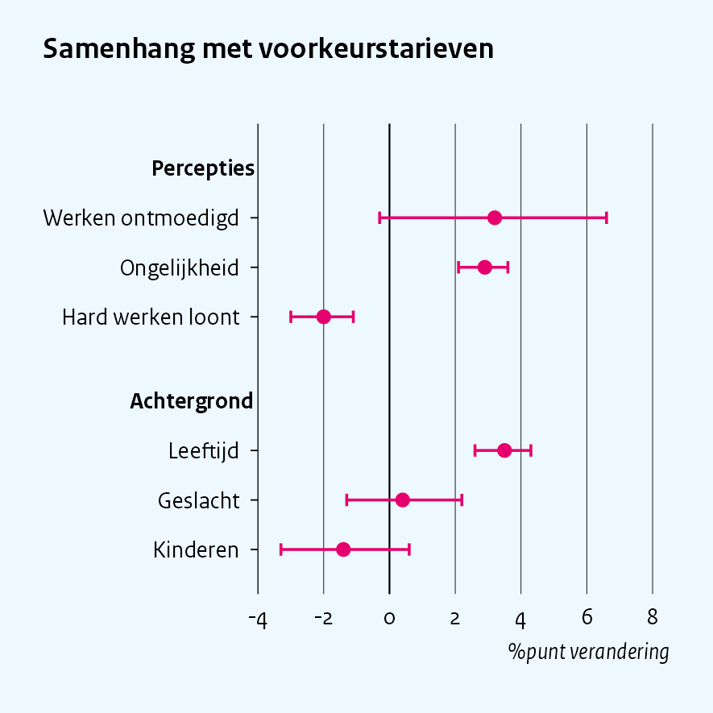

<div>

#### Relevant parameters

<table class="ptab">

<thead>

<tr>

<th style="text-align:left;">

parameter
</th>

<th style="text-align:right;">

value
</th>

</tr>

</thead>

<tbody>

<tr>

<td style="text-align:left;">

plot_type
</td>

<td style="text-align:right;">

dot
</td>

</tr>

<tr>

<td style="text-align:left;">

title
</td>

<td style="text-align:right;">

Samenhang met voorkeurstarieven
</td>

</tr>

<tr>

<td style="text-align:left;">

x
</td>

<td style="text-align:right;">

term
</td>

</tr>

<tr>

<td style="text-align:left;">

y
</td>

<td style="text-align:right;">

coef
</td>

</tr>

<tr>

<td style="text-align:left;">

lower
</td>

<td style="text-align:right;">

lo
</td>

</tr>

<tr>

<td style="text-align:left;">

upper
</td>

<td style="text-align:right;">

hi
</td>

</tr>

<tr>

<td style="text-align:left;">

group
</td>

<td style="text-align:right;">

blok
</td>

</tr>

<tr>

<td style="text-align:left;">

xlab
</td>

<td style="text-align:right;">

%punt verandering
</td>

</tr>

</tbody>

</table>

</div>

</div>

**How to reproduce this figure:** copy `params.csv`, the folder `data`
and `run_import.bat` (Windows) or `run_import.command` (Mac) to a
personal folder. Fill in the parameters above in `params.csv` and start
the script. In R you can call `cpb_dot()` instead. See section 1.4.

## Scatter plot

<div class="figrow">

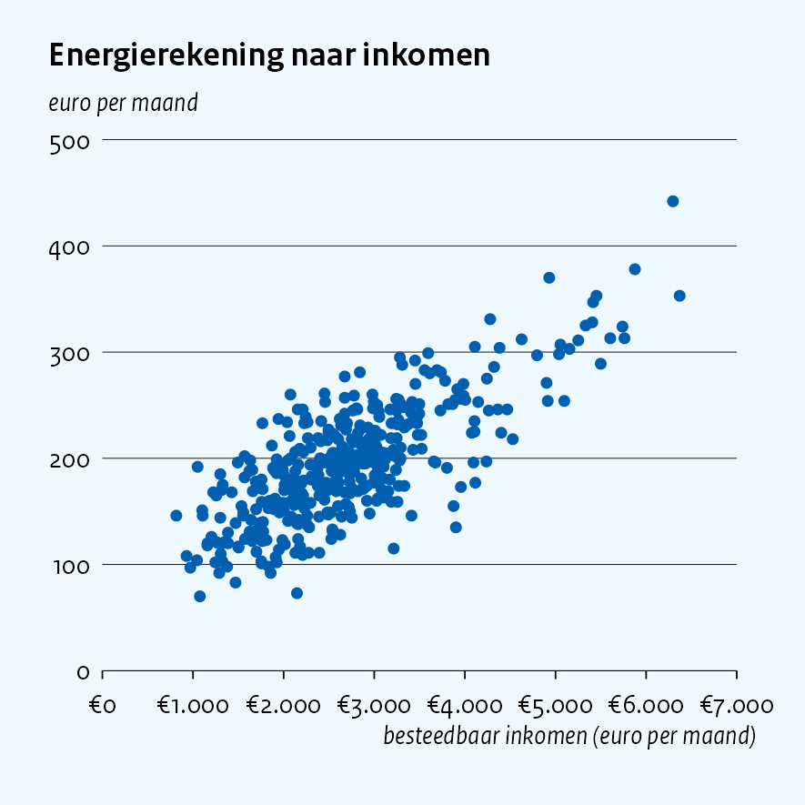

<div>

#### Relevant parameters

<table class="ptab">

<thead>

<tr>

<th style="text-align:left;">

parameter
</th>

<th style="text-align:right;">

value
</th>

</tr>

</thead>

<tbody>

<tr>

<td style="text-align:left;">

plot_type
</td>

<td style="text-align:right;">

scatter
</td>

</tr>

<tr>

<td style="text-align:left;">

title
</td>

<td style="text-align:right;">

Energierekening naar inkomen
</td>

</tr>

<tr>

<td style="text-align:left;">

x
</td>

<td style="text-align:right;">

inkomen
</td>

</tr>

<tr>

<td style="text-align:left;">

y
</td>

<td style="text-align:right;">

energierekening
</td>

</tr>

<tr>

<td style="text-align:left;">

ylab
</td>

<td style="text-align:right;">

euro per maand
</td>

</tr>

<tr>

<td style="text-align:left;">

xlab
</td>

<td style="text-align:right;">

besteedbaar inkomen (euro per maand)
</td>

</tr>

</tbody>

</table>

</div>

</div>

**How to reproduce this figure:** copy `params.csv`, the folder `data`
and `run_import.bat` (Windows) or `run_import.command` (Mac) to a
personal folder. Fill in the parameters above in `params.csv` and start
the script. In R you can call `cpb_scatter()` instead. See section 1.4.

## Histogram

<div class="figrow">

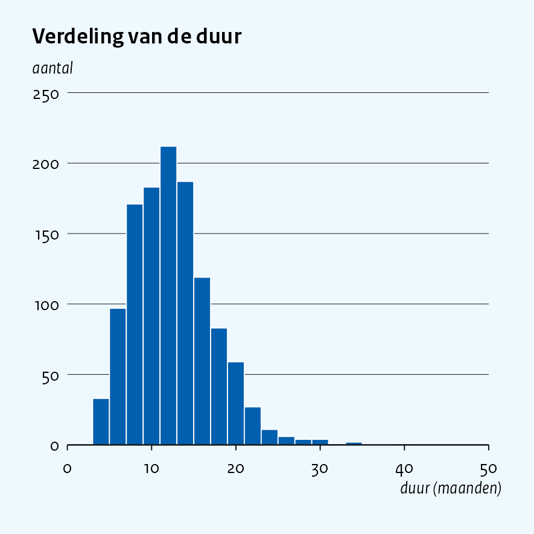

<div>

#### Relevant parameters

<table class="ptab">

<thead>

<tr>

<th style="text-align:left;">

parameter
</th>

<th style="text-align:right;">

value
</th>

</tr>

</thead>

<tbody>

<tr>

<td style="text-align:left;">

plot_type
</td>

<td style="text-align:right;">

hist
</td>

</tr>

<tr>

<td style="text-align:left;">

title
</td>

<td style="text-align:right;">

Verdeling van de duur
</td>

</tr>

<tr>

<td style="text-align:left;">

x
</td>

<td style="text-align:right;">

maanden
</td>

</tr>

<tr>

<td style="text-align:left;">

binwidth
</td>

<td style="text-align:right;">

2
</td>

</tr>

<tr>

<td style="text-align:left;">

ylab
</td>

<td style="text-align:right;">

aantal
</td>

</tr>

<tr>

<td style="text-align:left;">

xlab
</td>

<td style="text-align:right;">

duur (maanden)
</td>

</tr>

</tbody>

</table>

</div>

</div>

**How to reproduce this figure:** copy `params.csv`, the folder `data`
and `run_import.bat` (Windows) or `run_import.command` (Mac) to a
personal folder. Fill in the parameters above in `params.csv` and start
the script. In R you can call `cpb_hist()` instead. See section 1.4.

# Ggplot2 base allows for endless possibilities

Every ggcpb figure is a real ggplot2 object. This means you can add to
it with `+`. Each added piece changes the figure a little.

The next figure has a sharp rise between 2020 and 2021. We add a
reference line, and a text along the diagonal in dark pink italic
letters. The position comes from the coordinates of the data. The
`angle` follows the slope of the line.

``` r
stijging <- tibble(jaar = 2017:2024,
                   waarde = c(2.1, 2.3, 2.0, 1.9, 6.4, 6.8, 6.5, 6.6))

cpb_line(stijging, x = jaar, y = waarde,
  title = "Een scherpe stijging", ylab = "%") +
  geom_hline(yintercept = 6, linetype = "dashed", linewidth = 0.3) +
  annotate("text", x = 2020.2, y = 4.2, label = "scherpe stijging",
           angle = 72, colour = "#a0004e", fontface = "italic",
           size = 2.4, family = cpb_font_family())
```

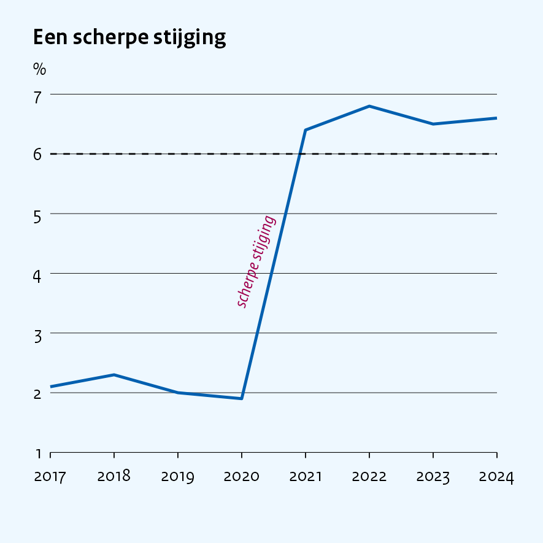

You can stack as many pieces as you need. More patterns are in
[`vignette("annotation")`](annotation.md).

## Classed map

The maps can display municipalities or provinces on bundled generalised
CBS/Kadaster boundaries. The following map colours each Dutch
municipality by class. The function `cpb_cut()` makes the classes, and
`label_pct_nl()` writes them as percentages. Maps are drawn in R. The
boundaries come with the package.

``` r
gemeenten <- tibble(code = unique(cpb_nl_geo("gemeente")$code)) |>
  mutate(aandeel = runif(n(), 5, 75),
         klasse  = cpb_cut(aandeel, breaks = c(0, 20, 30, 40, 50, 60, Inf),
                           labeller = label_pct_nl()))
```

<div class="figrow">

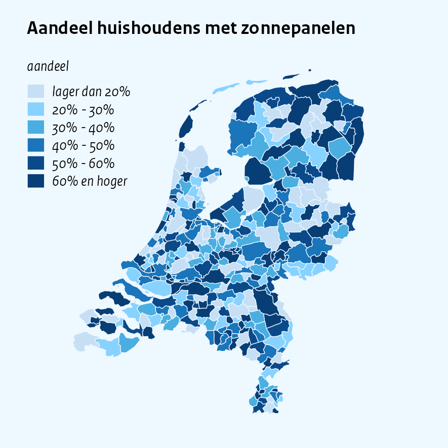

<div>

#### Relevant parameters

<table class="ptab">

<thead>

<tr>

<th style="text-align:left;">

parameter
</th>

<th style="text-align:right;">

value
</th>

</tr>

</thead>

<tbody>

<tr>

<td style="text-align:left;">

function
</td>

<td style="text-align:right;">

cpb_map
</td>

</tr>

<tr>

<td style="text-align:left;">

title
</td>

<td style="text-align:right;">

Aandeel huishoudens met zonnepanelen
</td>

</tr>

<tr>

<td style="text-align:left;">

region
</td>

<td style="text-align:right;">

code
</td>

</tr>

<tr>

<td style="text-align:left;">

value
</td>

<td style="text-align:right;">

cpb_cut(aandeel, labeller = label_pct_nl())
</td>

</tr>

<tr>

<td style="text-align:left;">

palette
</td>

<td style="text-align:right;">

blues
</td>

</tr>

<tr>

<td style="text-align:left;">

legend_title
</td>

<td style="text-align:right;">

aandeel
</td>

</tr>

</tbody>

</table>

</div>

</div>

Maps currently have no `params.csv` route. Call `cpb_map()` in R, as
described above. More options are in [`vignette("maps")`](maps.md).
